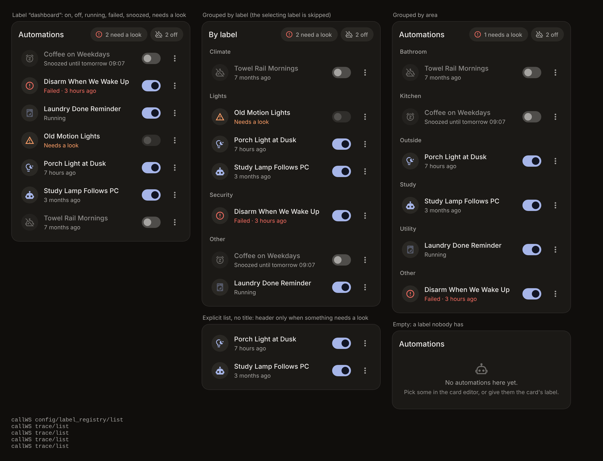
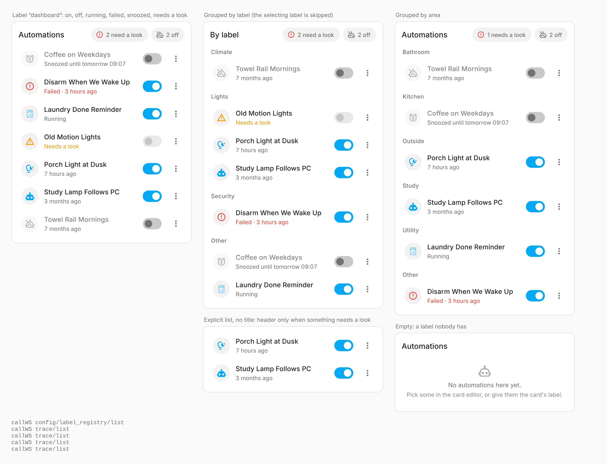
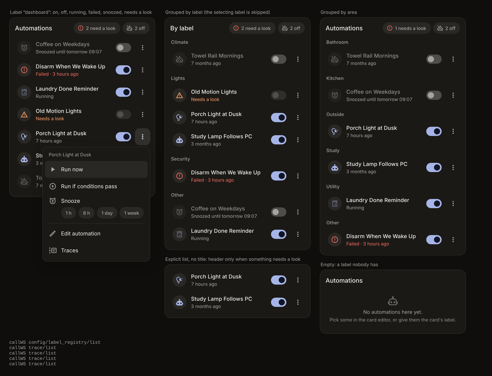

# Flow Pulse

[](https://hacs.xyz)

Your Home Assistant automations on the dashboard, calm and at a glance. Turn them on and off, run them, **snooze** them for an hour or a week, and see straight away which one failed last time or needs a look.





| The menu |
| --- |
|  |

## Features

- **One quiet row per automation**: icon, name, when it last ran, a switch and a ⋯ menu. An automation that is off steps back as a whole row, so the list reads at a glance.
- **Pick them, or label them**: list automations in the card, give them a label (for example *Dashboard*), or both. A new automation with the label shows up by itself.
- **Run** (skipping conditions) or **Run if conditions pass**, **Stop** a run in progress, and jump to the automation's **editor** or **traces** (admins).
- **Snooze**: off for 1 hour, 8 hours, a day or a week, and back on by itself, even with no dashboard open and across restarts. Turn it back on by hand and the snooze simply ends.
- **What needs a look**: a red icon and *Failed · 2 hours ago* when the last run ended in an error (read from the traces), orange *Needs a look* when Home Assistant can't load the automation. A running automation's icon breathes until the run ends.
- **Header counts**, shown only when there is something to count: *2 off*, *1 needs a look*. Tap one to see just those.
- **Ask first** for the automations that matter (the alarm, the heating): Home Assistant's own confirmation before turning them off, running or snoozing them.
- **Sections** by label, area or Home Assistant category, for longer lists.
- Light and dark, English and Greek. With the [Pulse theme](https://github.com/zacharatos/pulse-theme) it reads the shared `--pulse-*` tokens and sits with the other Pulse cards as one family; without it, it follows your Home Assistant theme.

## Why an integration and not just a card

A card only runs while a dashboard is open, and snoozing means turning an automation back on *later*, when nobody may be looking. So Flow Pulse is a tiny integration that keeps the snoozes and wakes them up on time, and it serves the card itself. One HACS install gives you both; there is no dashboard resource to add.

## Installation

### HACS (custom repository)

1. HACS → ⋮ → **Custom repositories** → add `https://github.com/zacharatos/flow-pulse`, type **Integration**.
2. Install **Flow Pulse** and restart Home Assistant.
3. **Settings → Devices & services → Add integration → Flow Pulse** (nothing to fill in).
4. Edit a dashboard → **Add card** → **Flow Pulse Card**.

### Manual

Copy `custom_components/flow_pulse` into your `config/custom_components/`, restart, then continue from step 3.

Minimum Home Assistant version: 2025.7.

## Configuration

```yaml
type: custom:flow-pulse-card
label: dashboard
```

With nothing set, the card shows every automation in the house (hidden ones excepted), by name.

| Option | Default | What it does |
| :- | :- | :- |
| `title` | *Automations* | Header title. An empty text hides it (the counts still show when there is something to count). |
| `entities` | – | Automations shown first, in this order. |
| `label` | – | A label id, or a list of them. Every automation with one of them is shown after `entities`, by name. |
| `exclude` | – | Never shown, even with the label. |
| `group_by` | `none` | `label`, `area` or `category`: section titles. The label that selects the automations is skipped when grouping by label. |
| `confirm` | – | Automations that ask before being turned off, run, stopped or snoozed. |

```yaml
type: custom:flow-pulse-card
title: Automations
entities:
  - automation.porch_light_at_dusk
label: [dashboard, holiday]
exclude:
  - automation.old_motion_lights
group_by: label
confirm:
  - automation.disarm_on_wake
```

## Using the card

- **Tap a row**: Home Assistant's more-info (history, attributes).
- **The switch**: on or off.
- **Hold a row, or tap ⋯**: the menu. *Run now*, *Run if conditions pass*, *Stop and turn off* (while running), *Snooze* (1 h · 8 h · 1 day · 1 week) or *Resume now*, *Edit automation* and *Traces* (admins).

Failed runs come from Home Assistant's traces, which only admins can read, so other users see the rest of the card without the red *Failed*.

## Snooze from automations, scripts and voice

| Action | Fields |
| :- | :- |
| `flow_pulse.snooze` | target (automations, or an area/device/label), `duration` **or** `until` (at most 30 days) |
| `flow_pulse.resume` | target |

Rules: an automation that is already off and not snoozed is left alone (it was switched off on purpose). A run in progress finishes. Turning a snoozed automation on by hand ends the snooze. Renaming its entity id keeps the snooze. Deleting the Flow Pulse integration turns every snoozed automation back on.

```yaml
# Leaving for the weekend: snooze everything labelled "presence" until Sunday evening.
actions:
  - action: flow_pulse.snooze
    target:
      label_id: presence
    data:
      until: "2026-10-18 19:00:00"
```

```yaml
# Guests stay over: no motion lights in the living room for 8 hours.
actions:
  - action: flow_pulse.snooze
    target:
      entity_id: automation.living_room_motion_lights
    data:
      duration: "08:00:00"
```

## Development

```bash
npm install
npm run typecheck && npm test && npm run build   # card (rebuild leaves the bundle modified; CI checks it)
bash scripts/install-test-deps.sh && pytest -q    # integration
python -m http.server 8765                        # then open http://localhost:8765/test/harness.html
```

The harness takes `?dark`, `?lang=el`, `?theme=pulse|glass|tonal` (serve the parent folder with the sibling `pulse-theme` repo and open `/flow-pulse/test/harness.html`), `?menu` (opens a menu), `?user` (not an admin) and `?nosnooze` (no integration).

## License

MIT
